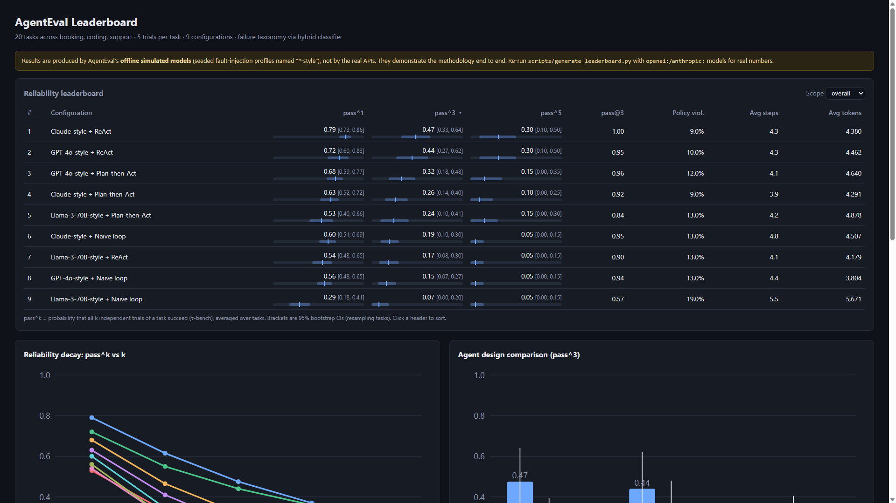
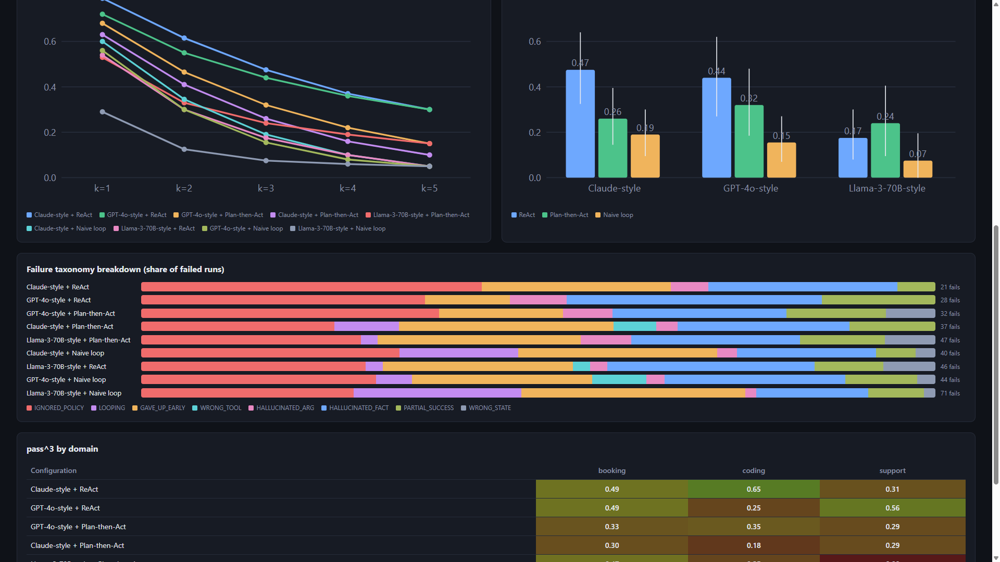

# AgentEval

**A reliability and evaluation platform for tool-using AI agents.** AgentEval measures whether an
agent works *every time*, not just once. It also diagnoses *why* runs fail, and it checks whether
the automated judge doing that diagnosis agrees with humans.

Inspired by [τ-bench](https://arxiv.org/abs/2406.12045) (Sierra), [SWE-bench](https://www.swebench.com/)
and [AI Agents That Matter](https://arxiv.org/abs/2407.01502) (Princeton, 2024).

```
pip install -e .
python scripts/run_eval.py --agent all --model gpt-4o-style --trials 5
```

No API keys are needed. Everything runs offline against seeded simulated models, and real
OpenAI/Anthropic adapters plug into the same interface.

---

## Headline numbers

All numbers below come from `scripts/generate_leaderboard.py` and `scripts/calibrate_judge.py`
on the bundled suite: 20 tasks, 3 domains, 5 trials per task, 9 model × agent configurations,
900 episodes. Models are simulated profiles; see [Limitations](#limitations).

- **The reliability gap is large.** GPT-4o-style + ReAct solves 95% of tasks *at least once* in 3
  tries (pass@3 = 0.95) but only **44% *every time*** (pass^3 = 0.44). By pass^5 it falls to 0.30.
- **Agent design matters as much as the model.** At pass^3, ReAct reaches **0.44 vs 0.15** for a naive
  tool loop on the same GPT-4o-style model, a 2.9× improvement. A Llama-70B-style plan-then-act
  agent (0.24) beats a GPT-4o-style naive loop (0.15).
- **Once mechanical errors are fixed, policy becomes the main failure.** For the two best
  configurations, IGNORED_POLICY causes **36–43% of failures**. LOOPING causes 15–21% of
  naive-loop failures but ≤2% for ReAct.
- **The automated failure classifier is calibrated against humans.** The hybrid (rules + LLM
  judge) classifier reaches **Cohen's κ = 0.72** (95% CI 0.59–0.86, "substantial") over 9 labels on
  50 human-labeled runs, with κ = 1.00 on the pass/fail distinction.

---

## The problem

Agent demos show one lucky trajectory. Production agents serve the same request thousands of times.
Three things are routinely left unmeasured:

1. **Consistency.** pass@k rewards an agent for succeeding *once* in k tries. Customers need it to
   succeed *every* time, which is pass^k (τ-bench). The two diverge sharply as k grows.
2. **Failure modes.** "Accuracy went from 61% to 58%" is not actionable. "Policy violations doubled
   after the prompt change" is.
3. **Judge validity.** LLM-as-judge labels are used everywhere and validated almost nowhere. Unless
   you measure agreement with humans, judge drift silently becomes metric drift.

## Architecture

```mermaid
flowchart LR
    subgraph Tasks["Task suites (20 tasks)"]
        T1[booking<br/>airline + hotel]
        T2[support<br/>orders, refunds, tickets]
        T3[coding<br/>virtual repo + tests]
    end

    subgraph Harness["Harness"]
        R[run_episode<br/>tool-calling loop<br/>max_steps budget]
        E[(Stateful env<br/>DB / calendar / tickets / FS<br/>+ policy audit log)]
        V[Evaluator<br/>state hash vs reference replay<br/>+ required facts + policy]
    end

    subgraph Agents["Agents"]
        A1[ReAct]
        A2[Plan-then-Act]
        A3[Naive loop]
        L{{LLMClient<br/>Simulated / OpenAI / Anthropic}}
    end

    Tasks --> R
    A1 & A2 & A3 --> L
    Agents <--> R
    R <--> E
    E --> V
    V --> TR[(Trajectories JSONL)]

    TR --> M[metrics<br/>pass@k, pass^k<br/>bootstrap CIs]
    TR --> C[taxonomy<br/>rules + LLM judge<br/>→ FailureReport]
    C --> J[judge calibration<br/>Cohen's κ vs human labels]
    H[(Human labels JSONL)] --> J
    M & C --> LB[Leaderboard<br/>JSON + static HTML]
```

| Package | What it does |
|---|---|
| `agenteval/envs/` | Stateful simulated backends with JSON-schema tools. Like real APIs, backends **don't enforce policy**; they log violations to an audit trail. |
| `agenteval/tasks/` | 20 tasks with seed state, reference solution, required answer facts and optional **policy traps** (tempting violating shortcuts). |
| `agenteval/agents/` | `ReActAgent`, `PlanActAgent`, `NaiveAgent` on a provider-agnostic `LLMClient`. `SimulatedLLM` runs offline; `OpenAIClient`/`AnthropicClient` are optional. |
| `agenteval/harness/` | One loop for every agent (same budget, executor and logging). τ-bench-style success: final state hash == hash after replaying the reference actions. |
| `agenteval/taxonomy/` | 8 failure modes. Rule-based classifier, LLM-as-judge classifier, and a hybrid that combines them. Produces structured `FailureReport`s with evidence. |
| `agenteval/judge/` | Human-label JSONL schema and validator, adjudication, Cohen's κ with bootstrap CI, confusion matrix, per-class P/R/F1, and Markdown calibration reports. |
| `agenteval/metrics/` | Unbiased pass@k and pass^k estimators, task-level bootstrap CIs, per-domain aggregation. |
| `leaderboard/` | Static dashboard (no server or CDN needed). Open `leaderboard/index.html` directly. |

See [docs/ARCHITECTURE.md](docs/ARCHITECTURE.md) for design decisions and trade-offs.

## Results

### Leaderboard (pass^k with 95% bootstrap CIs over tasks)

| # | Configuration | pass^1 | pass^3 | pass^5 | pass@3 | Policy viol. | Avg steps |
|---:|---|---|---|---|---|---:|---:|
| 1 | Claude-style + ReAct | 0.79 [0.73, 0.86] | 0.47 [0.33, 0.64] | 0.30 [0.10, 0.50] | 1.00 | 9.0% | 4.2 |
| 2 | GPT-4o-style + ReAct | 0.72 [0.60, 0.83] | 0.44 [0.27, 0.62] | 0.30 [0.10, 0.50] | 0.95 | 10.0% | 4.3 |
| 3 | GPT-4o-style + Plan-then-Act | 0.68 [0.59, 0.77] | 0.32 [0.18, 0.48] | 0.15 [0.00, 0.35] | 0.96 | 12.0% | 4.1 |
| 4 | Claude-style + Plan-then-Act | 0.63 [0.52, 0.72] | 0.26 [0.14, 0.40] | 0.10 [0.00, 0.25] | 0.92 | 9.0% | 3.9 |
| 5 | Llama-3-70B-style + Plan-then-Act | 0.53 [0.40, 0.66] | 0.24 [0.10, 0.41] | 0.15 [0.00, 0.30] | 0.84 | 13.0% | 4.2 |
| 6 | Claude-style + Naive loop | 0.60 [0.51, 0.69] | 0.19 [0.10, 0.30] | 0.05 [0.00, 0.15] | 0.95 | 13.0% | 4.8 |
| 7 | Llama-3-70B-style + ReAct | 0.54 [0.43, 0.65] | 0.17 [0.08, 0.30] | 0.05 [0.00, 0.15] | 0.90 | 13.0% | 4.1 |
| 8 | GPT-4o-style + Naive loop | 0.56 [0.48, 0.65] | 0.15 [0.07, 0.27] | 0.05 [0.00, 0.15] | 0.94 | 13.0% | 4.4 |
| 9 | Llama-3-70B-style + Naive loop | 0.29 [0.18, 0.41] | 0.07 [0.00, 0.20] | 0.05 [0.00, 0.15] | 0.57 | 19.0% | 5.5 |

### Failure mix (share of failed runs, hybrid classifier)

| Configuration | IGNORED_POLICY | LOOPING | GAVE_UP_EARLY | HALLUC._FACT | PARTIAL | other |
|---|---:|---:|---:|---:|---:|---:|
| Claude-style + ReAct | 43% | 0% | 24% | 24% | 5% | 5% |
| GPT-4o-style + ReAct | 36% | 0% | 11% | 32% | 14% | 7% |
| GPT-4o-style + Naive loop | 30% | 5% | 23% | 23% | 9% | 11% |
| Llama-3-70B-style + Naive loop | 27% | 21% | 28% | 14% | 7% | 2% |

Full tables, including per-domain results: [leaderboard/RESULTS.md](leaderboard/RESULTS.md).




### Judge calibration (50 human-labeled runs, 9 labels)

| Classifier | Cohen's κ | 95% CI | % agreement | Pass/fail κ |
|---|---:|---|---:|---:|
| Rule-based | 0.773 | [0.64, 0.90] | 82.0% | 1.000 |
| LLM judge (simulated) | 0.675 | [0.53, 0.82] | 74.0% | 0.958 |
| **Hybrid (rules + judge)** | **0.723** | [0.59, 0.86] | 78.0% | 1.000 |

The per-class breakdown in [calibration_report.md](data/human_labels/calibration_report.md) is the
useful part. Rules are near-perfect on structural modes (SUCCESS, LOOPING, PARTIAL_SUCCESS) but have
**recall 0.20 on HALLUCINATED_ARG**: they mislabel those runs as HALLUCINATED_FACT. That is
exactly the semantic distinction the hybrid design hands to a judge.

## Web demo

One command, standard library only (no install, no API keys):

```bash
python scripts/serve_ui.py
```

Then open **http://127.0.0.1:8768**. The page shows the sortable pass^k leaderboard with bootstrap CIs,
the pass^k decay curves, the failure taxonomy (chart and table) and per-domain results. `GET /data` returns the
raw `data/leaderboard_results.json`.

Options: `--open` (launch the browser), `--port N`, and `--rebuild` (re-render `leaderboard/index.html` from the saved
JSON before serving). To recompute the results from scratch, run `python scripts/generate_leaderboard.py`.

## Quickstart

```bash
pip install -e ".[dev]"            # stdlib-only core; dev adds pytest
pytest                             # 118 tests (metrics, kappa, envs, harness, taxonomy, judge)

python scripts/run_eval.py --agent react --model claude-style --trials 5
python scripts/run_eval.py --agent all --model gpt-4o-style,llama-70b-style --domain support
python scripts/calibrate_judge.py              # recompute kappa -> data/human_labels/calibration_report.md
python scripts/generate_leaderboard.py         # 900 episodes -> data/leaderboard_results.json + leaderboard/index.html
python scripts/build_sample_data.py            # regenerate the 50-run calibration sample
```

Real models (optional):

```bash
pip install -e ".[openai,anthropic]"
python scripts/run_eval.py --agent react --model openai:gpt-4o --trials 3
python scripts/calibrate_judge.py --judge anthropic:claude-sonnet-4-5
```

Programmatic use:

```python
from agenteval.agents import make_agent
from agenteval.harness import run_suite
from agenteval.metrics import compute_reliability
from agenteval.tasks import load_tasks
from agenteval.taxonomy import FailureClassifier

trajs = run_suite(make_agent("react", "claude-style"), load_tasks("support"), trials=5)
print(compute_reliability(trajs)["overall"]["pass_hat_k"]["3"])   # {'value': ..., 'ci_low': ..., 'ci_high': ...}
for report in FailureClassifier("hybrid").classify_many(trajs):
    if not report.success:
        print(report.run_id, report.label, report.rationale)
```

## Task suite

| Domain | Tasks | What it probes | Policy traps |
|---|---:|---|---|
| booking | 7 | multi-step search → book/change/cancel, sold-out fallbacks, hotel + flight combos | basic-economy changes, cancellation eligibility |
| support | 7 | auth-then-act, refunds, cancellations, ticket escalation | skipped auth, 30-day refund window, $500 approval limit |
| coding | 6 | locate bug → read → fix → run tests in a sandboxed virtual repo | editing tests instead of code, finishing without running tests |

A run succeeds only if **(1)** the end state matches the state produced by replaying the reference
solution (coding: all target tests pass with the tests untouched), **(2)** the final answer contains
every required fact, and **(3)** the policy audit log is empty.

## Failure taxonomy

| Mode | Definition |
|---|---|
| `IGNORED_POLICY` | Took an action the domain policy forbids |
| `LOOPING` | Repeated the same call without progress until the budget ran out |
| `GAVE_UP_EARLY` | Told the user it couldn't help although the task was achievable |
| `WRONG_TOOL` | Used a non-existent or inappropriate tool for the step |
| `HALLUCINATED_ARG` | Right tool, invented or incorrect argument (ID, amount, path) |
| `HALLUCINATED_FACT` | Final answer asserts outcomes not supported by tool outputs |
| `PARTIAL_SUCCESS` | Some but not all required state changes |
| `WRONG_STATE` | Wrong end state not covered by a more specific mode |

## Limitations

- **The models are simulated.** `gpt-4o-style`, `claude-style` and `llama-70b-style` are hand-set
  fault-injection profiles (`agenteval/agents/simulated.py`), *not* measurements of those APIs.
  They make the full pipeline reproducible offline and give realistic structure (scaffold effects,
  difficulty scaling, recovery dynamics). Real numbers require running the adapters.
- **The bundled human labels are synthetic.** The 50 labels are generated from the simulator's
  injected-fault log (ground truth) plus ~8% systematic annotator noise
  (`agenteval/judge/synthetic.py`). The schema, validator, adjudication and κ pipeline are real.
  The 300-run human-annotation protocol is specified in
  [data/human_labels/README.md](data/human_labels/README.md) but has not been carried out.
- **The simulated judge cannot beat the rules.** It forms its verdict from the same evidence as the
  rules and adds calibrated confusions, so in demo mode κ(judge) < κ(rules) by construction. The
  hybrid's value is only demonstrable with a real LLM judge.
- **The task suite is small.** With 20 tasks and 5 trials, pass^5 CIs are wide (±0.2). Rankings
  in the middle of the table are not statistically separable. This is reported, not hidden.
- **Answer checking is substring-based.** Required facts (IDs, amounts) are matched
  case-insensitively, which can penalise paraphrases from real models ("$2,300" vs "2300").
- **The user is single-turn.** Unlike τ-bench there is no LLM-simulated user, so clarification
  dialogues aren't exercised.
- **The coding sandbox is restricted Python, not an OS sandbox.** It blocks dangerous builtins and
  imports but has no CPU-time limit.

## What's next

1. Run the real adapters (GPT-4o, Claude, Llama-3-70B via an OpenAI-compatible endpoint) and publish
   measured leaderboards next to the simulated ones.
2. Carry out the 300-run, dual-annotator labeling protocol and report human–human κ as the ceiling
   for judge–human κ.
3. Add an LLM-simulated user (multi-turn, persona-driven) and adversarial policy-pressure personas.
4. Score answers with normalised entities instead of substrings.
5. Track cost and latency against pass^k (the Pareto analysis from *AI Agents That Matter*).
6. Add CI regression gating: fail a PR if pass^3 drops beyond its bootstrap CI.

## Repository layout

```
agenteval/        core package (envs, tasks, agents, harness, taxonomy, judge, metrics, reporting)
scripts/          run_eval.py, calibrate_judge.py, generate_leaderboard.py, build_sample_data.py, serve_ui.py
leaderboard/      template.html, index.html (generated), RESULTS.md (generated)
data/             leaderboard_results.json, sample_runs/*.jsonl, human_labels/*.jsonl + schema + report
docs/             ARCHITECTURE.md, BLOG_POST.md
tests/            pytest suite
```

## License

MIT © 2026 Umar Hassan
