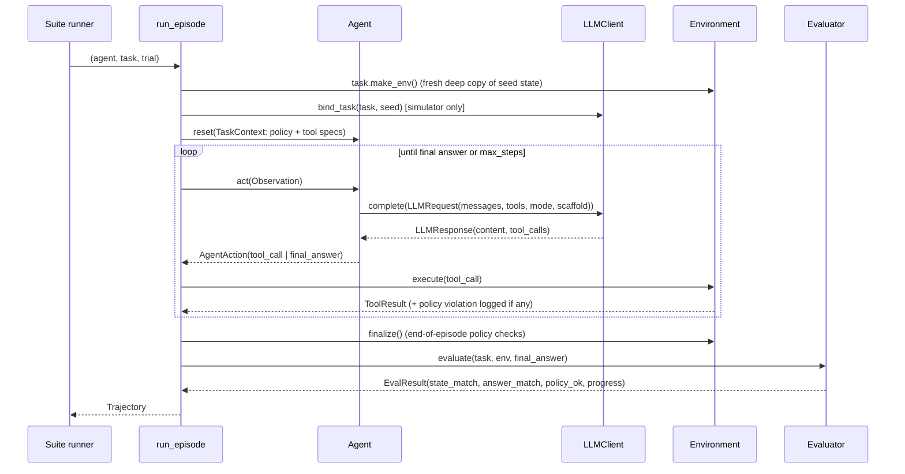

# AgentEval architecture

This document explains how the system is put together and why. It is aimed at someone
extending the platform or reviewing its methodology.

## 1. Data flow



Each `Trajectory` is a self-contained JSON record. Metrics, failure classification, calibration
and the leaderboard all consume trajectories and never re-run agents. As a result, analysis can be
re-run cheaply on stored runs, including runs from real APIs.

## 2. Key design decisions

### The harness owns the loop, not the agent
Agents implement `act(observation) -> action`. The step budget, tool executor, error handling and
logging live in one place (`harness/runner.py`). This guarantees that ReAct, plan-then-act and
the naive baseline are compared under identical conditions. In ad-hoc agent comparisons, a hidden
difference in retry logic or step limits often matters more than the design being compared.
Agent crashes are recorded as `termination="agent_error"`, a measured outcome rather than a
harness crash.

### State-based success, τ-bench style
Text-matching a "correct answer" is brittle for agents that act. Instead:

```
expected_hash = hash(replay(reference_actions, seed_state))
success = env.state_hash() == expected_hash  and  required_facts ⊆ answer  and  audit_log == []
```

- Free-text fields (`reason`, `note`, `subject`) are stripped before hashing, so a refund issued
  with a differently worded reason still counts.
- Reference replay is validated: if a reference action errors or violates policy, the task itself
  is broken and `ReferenceSolutionError` is raised. `tests/test_harness.py` replays every reference
  solution, and the `oracle` profile must solve 100% of tasks under every agent design.
- Coding tasks replace the state hash with "all target tests pass and tests are unmodified".
  Progress is the fraction of *initially failing* tests now passing.

### Backends don't enforce policy
`SupportEnv.issue_refund` will refund a 56-day-old order, just as a real payments API would.
The violation goes to `env.violations`. This is what makes policy adherence *measurable*: an agent
can do the wrong thing, and we see it. Policy traps (`PolicyTrap`) document the tempting shortcut
each policy task is designed to probe.

### pass^k with unbiased estimators and task-level bootstrap
- `pass_hat_k(n, c, k) = C(c, k) / C(n, k)`. This is the probability that k trials drawn without
  replacement from n all succeed. It is unbiased for n ≥ k and uses all n trials, rather than only
  the first k.
- CIs come from bootstrap resampling over **tasks**, because tasks are the independent unit.
  Resampling individual trials would treat 5 correlated attempts at one task as 5 independent
  observations and understate variance.

### A failure taxonomy built around root causes
Each failed run gets one **primary** label (the root cause) plus secondary labels and evidence.
The rule classifier applies a fixed priority:

```
IGNORED_POLICY > LOOPING > GAVE_UP_EARLY > WRONG_TOOL > HALLUCINATED_ARG
               > HALLUCINATED_FACT > PARTIAL_SUCCESS > WRONG_STATE
```

Structural modes come first because their evidence is unambiguous (audit log, exact repeated
call signatures). Errors that were *recovered from* (for example, an unknown-tool call followed by
a correct one) are recorded as evidence only and never become the primary label. Without that
rule, every run containing a harmless early mistake would be misattributed.

### A hybrid classifier
| Situation | Who decides | Why |
|---|---|---|
| Run succeeded | evaluator (rules) | success is ground truth from state, not an opinion |
| Policy violation / looping | rules | hard evidence; an LLM can only add noise |
| Everything else | LLM judge | distinguishing "wrong tool" from "hallucinated argument", or "partial" from "wrong state", needs semantic reading of the transcript |

The judge may not overturn a failed run to SUCCESS. The calibration report quantifies the
trade-off: rules have recall 0.20 on HALLUCINATED_ARG in the bundled sample, and that gap is what
the judge exists to close.

### Calibration as a first-class artefact
`judge/` treats "is the judge any good?" as a measurement with its own error bars:
- versioned JSONL label schema with a dependency-free validator,
- multi-annotator adjudication (majority vote, confidence-weighted tie-break),
- Cohen's κ with a bootstrap CI, a full confusion matrix, per-class precision/recall/F1,
- a separate pass/fail κ, because a judge can be perfect at "did it fail?" and poor at "why?".

## 3. The simulator (demo mode)

`SimulatedLLM` is not a language model. It walks the task's reference plan and, at each
decision, draws faults from a `FaultRates` profile:

```
effective_rate = model_rate × scaffold_multiplier × difficulty_factor
```

| Fault | Taxonomy mode it produces | Recoverable? |
|---|---|---|
| `wrong_tool` | WRONG_TOOL | yes, if it errors |
| `hallucinated_arg` | HALLUCINATED_ARG | yes, if it errors (bad ID); no, if it silently succeeds (wrong amount) |
| `loop` | LOOPING | exits with probability `1 - loop_persist` per step |
| `give_up` | GAVE_UP_EARLY | terminal |
| `premature_finish`, `plan_omission` | PARTIAL_SUCCESS / HALLUCINATED_FACT | terminal |
| `policy_slip` (at a trap) | IGNORED_POLICY | terminal |
| `hallucinated_fact` | HALLUCINATED_FACT | terminal |

Scaffold multipliers encode qualitative claims from the literature. They are inputs to the
simulation, not findings:
- **ReAct**: explicit reasoning plus an injected reflection message on tool errors, which gives a
  higher recovery rate and shorter loops.
- **Plan-then-act**: fewer wrong-tool and loop faults, but plans can omit steps, and execution
  recovers less well.
- **Naive**: higher fault rates, weak recovery, sticky loops.

Every injected fault is logged with `errored` and `recovered` flags. That log is the ground truth
for the synthetic human labels (`judge/synthetic.py`), which is why rule-classifier agreement can be
measured honestly. The rules only ever see observable artefacts, never the fault log.

## 4. Extending

| To add... | Do this |
|---|---|
| a domain | subclass `Environment`, declare tools with `@tool(...)`, write a `POLICY`, register in `envs.ENV_REGISTRY`, and add a task module plus registry entry |
| a task | add a `Task` with seed state, reference actions, required facts and optionally a `PolicyTrap`; `pytest` validates the reference replay automatically |
| an agent design | subclass `Agent`, implement `system_prompt` and `decide`, and register in `AGENT_REGISTRY` |
| a model provider | implement `LLMClient.complete`; tool specs convert via `ToolSpec.to_openai()` / `to_anthropic()` |
| a judge | pass any `LLMClient` to `FailureClassifier("hybrid", judge_llm=...)` and run `scripts/calibrate_judge.py --judge ...` |

## 5. Performance

The 900-episode leaderboard grid (20 tasks × 5 trials × 9 configurations) plus failure
classification and 1,000-resample bootstraps runs in about 35 s on a laptop, single-threaded and
stdlib-only. Expected-state hashes are cached per task. Real-API runs are dominated by model
latency; `run_suite` is a natural place to add a thread pool.
